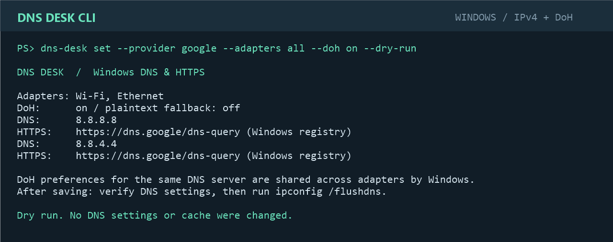

# DNS Desk CLI

**Choose DNS servers, configure DNS over HTTPS, and manage Wi-Fi and Ethernet from your Windows terminal.**

DNS Desk is a portable command-line tool for the DNS settings you would otherwise change in Windows Settings. It offers interactive setup, scriptable commands, automatic HTTPS template lookup, and a dry-run mode. No desktop UI, background service, or installer.

[Download the latest Windows x64 release](https://github.com/Gestusition/dns-desk/releases/latest) · [Commands](#commands) · [Build](#build-from-source)



*Terminal preview rendered from the CLI's dry-run output. Generating it does not modify network settings.*

## What it does

- Select all physical adapters, Wi-Fi, Ethernet, adapter names, or interface indexes. Disconnected adapters are included.
- Use Google, Cloudflare, or Quad9 presets, or provide custom IPv4 DNS servers.
- Find DoH templates from Windows' registered resolver definitions first, then from the documented provider catalog.
- Enable or disable DoH, with plaintext fallback disabled by default.
- Preview changes with `--dry-run`, or produce JSON for scripts with `--json`.
- Verify saved assignments and DoH definitions, then run `ipconfig /flushdns`.
- Attempt to restore the previous adapter assignments and DoH definitions if any apply step fails.
- Restore automatic DNS without changing IP addresses or IPv6 settings.

## Quick start

Download `dns-desk.exe` from [Releases](https://github.com/Gestusition/dns-desk/releases/latest), open PowerShell or Windows Terminal in its folder, and run:

```powershell
.\dns-desk.exe
```

This starts a terminal wizard. Or preview the original Google DNS configuration for both adapters:

```powershell
.\dns-desk.exe set --provider google --adapters all --doh on --dry-run
```

Apply it:

```powershell
.\dns-desk.exe set --provider google --adapters all --doh on --yes
```

Read-only commands and dry runs do not require administrator access. Applying settings requests UAC permission when your terminal is not already elevated. Results return to your original terminal.

## Requirements

- Windows 11 x64 with the Windows DNS-over-HTTPS cmdlets available.
- PowerShell 7 is preferred; built-in Windows PowerShell 5.1 is the fallback.
- The release is a self-contained, single-file .NET application; no separate .NET installation is required. .NET can extract bundled native components to its temporary runtime cache.

## Commands

| Command | Purpose |
| --- | --- |
| `dns-desk` | Interactive terminal setup |
| `dns-desk status` | Show adapters, IPv4 DNS, and registered DoH settings |
| `dns-desk providers` | List presets and HTTPS endpoints |
| `dns-desk doh 8.8.8.8` | Find a DoH template and show its source |
| `dns-desk set --provider google` | Configure a provider preset |
| `dns-desk set --dns 8.8.8.8,8.8.4.4` | Configure custom addresses |
| `dns-desk reset --adapters all` | Restore automatic DNS |
| `dns-desk help` | Full usage and options |

Options for `set`:

| Option | Default / behavior |
| --- | --- |
| `--provider google\|cloudflare\|quad9` | Use exactly one of `--provider` or `--dns` |
| `--dns <IPv4[,IPv4]>` | Preferred DNS plus an optional alternate |
| `--adapters all\|wifi\|ethernet\|name\|index` | `all`; comma-separated selections are supported |
| `--doh on\|off` | `on` |
| `--fallback on\|off` | `off`; applies only when DoH is on |
| `--template <https://...>` | Explicit endpoint for both addresses |
| `--secondary-template <https://...>` | Override only the alternate endpoint |
| `--dry-run` | Validate and preview; no DNS changes, cache flush, or UAC request |
| `--yes` | Skip the terminal confirmation |
| `--json` | Machine-readable output; applying requires `--yes` |

Names with spaces must be quoted:

```powershell
.\dns-desk.exe set --provider cloudflare --adapters "USB Ethernet" --yes
.\dns-desk.exe set --provider quad9 --adapters wifi,5 --dry-run
.\dns-desk.exe status --json
.\dns-desk.exe reset --adapters all --yes
```

Custom resolver examples:

```powershell
# Standard DNS without HTTPS
.\dns-desk.exe set --dns 192.168.1.1 --doh off --dry-run

# Custom HTTPS endpoint; substitute your resolver's documented address and URL
.\dns-desk.exe set --dns 192.0.2.1 --template https://resolver.example/dns-query --dry-run

# Different endpoints for the preferred and alternate servers
.\dns-desk.exe set --dns 192.0.2.1,8.8.4.4 `
  --template https://resolver.example/dns-query `
  --secondary-template https://dns.google/dns-query --dry-run
```

Exit codes: **0** = success, preview, or interactive cancellation; **1** = operation failure or no template found; **2** = invalid arguments or an unconfirmed noninteractive apply.

## Automatic DoH lookup

The lookup follows the resolver definitions available to Windows through [`Get-DnsClientDohServerAddress`](https://learn.microsoft.com/en-us/powershell/module/dnsclient/get-dnsclientdohserveraddress). A valid registered HTTPS definition takes precedence. If Windows has no definition, DNS Desk checks its local provider catalog:

| Provider | Preferred / alternate | HTTPS endpoint |
| --- | --- | --- |
| Google | `8.8.8.8` / `8.8.4.4` | `https://dns.google/dns-query` |
| Cloudflare | `1.1.1.1` / `1.0.0.1` | `https://cloudflare-dns.com/dns-query` |
| Quad9 | `9.9.9.9` / `149.112.112.112` | `https://dns.quad9.net/dns-query` |

Catalog references: [Google Public DNS](https://developers.google.com/speed/public-dns/docs/doh), [Cloudflare](https://developers.cloudflare.com/1.1.1.1/encryption/dns-over-https/make-api-requests/), [Quad9](https://docs.quad9.net/services/).

For unknown addresses, DNS Desk requires a manually supplied HTTPS endpoint. It does not guess URLs, download third-party resolver lists, or perform network DDR discovery. Setting the configured values is verified; endpoint reachability and actual on-wire encryption are not tested.

## Windows behavior and scope

DNS assignments apply only to the selected physical adapters and IPv4. IP addressing and existing IPv6 DNS are preserved, so this tool does not enable encrypted DNS for every possible resolver on the machine.

Windows stores DoH preferences per resolver address. Updating encryption or fallback for a DNS server can affect other adapters using that same server. This matches the scope of [`Set-DnsClientDohServerAddress`](https://learn.microsoft.com/en-us/powershell/module/dnsclient/set-dnsclientdohserveraddress). Restoring automatic DNS leaves those global DoH definitions in place.

Before applying, the backend captures manual-versus-automatic DNS assignments and existing DoH definitions. If a step fails, it attempts to restore the settings it touched and reports any restoration failures explicitly. It never kills an apply process mid-transaction.

## Build from source

Install the [.NET 8 SDK](https://dotnet.microsoft.com/download/dotnet/8.0), then:

```powershell
git clone https://github.com/Gestusition/dns-desk.git
cd dns-desk
dotnet build src/DnsDesk.Cli -c Release
dotnet run --project src/DnsDesk.Cli -- status
```

Build the portable release:

```powershell
pwsh -File scripts/Publish.ps1
# artifacts/publish/dns-desk.exe
```

## Verification

```powershell
pwsh -File scripts/Test.ps1
```

The suite covers CLI parsing, adapter selection, IPv4 and HTTPS validation, Windows-first template lookup, partial-failure rollback, DHCP restoration, newly added DoH definition cleanup, and JSON/dry-run command behavior. Transaction tests use in-memory cmdlet substitutes. Integration checks read real Windows state without changing DNS or flushing the cache; the suite does not grant UAC or perform a live network mutation.

GitHub Actions builds the CLI, runs these checks on Windows, and produces a portable executable. Tags beginning with `v` publish an executable and SHA-256 checksum as release assets.

## Project layout

```text
src/DnsDesk.Core/       Settings validation, provider catalog, command parsing
src/DnsDesk.Cli/        Terminal commands and embedded PowerShell backend
tests/                 Core checks, simulated transactions, read-only CLI checks
scripts/               Build, verification, and documentation preview
docs/images/           Terminal preview used in this README
```

## License

[MIT](LICENSE).
